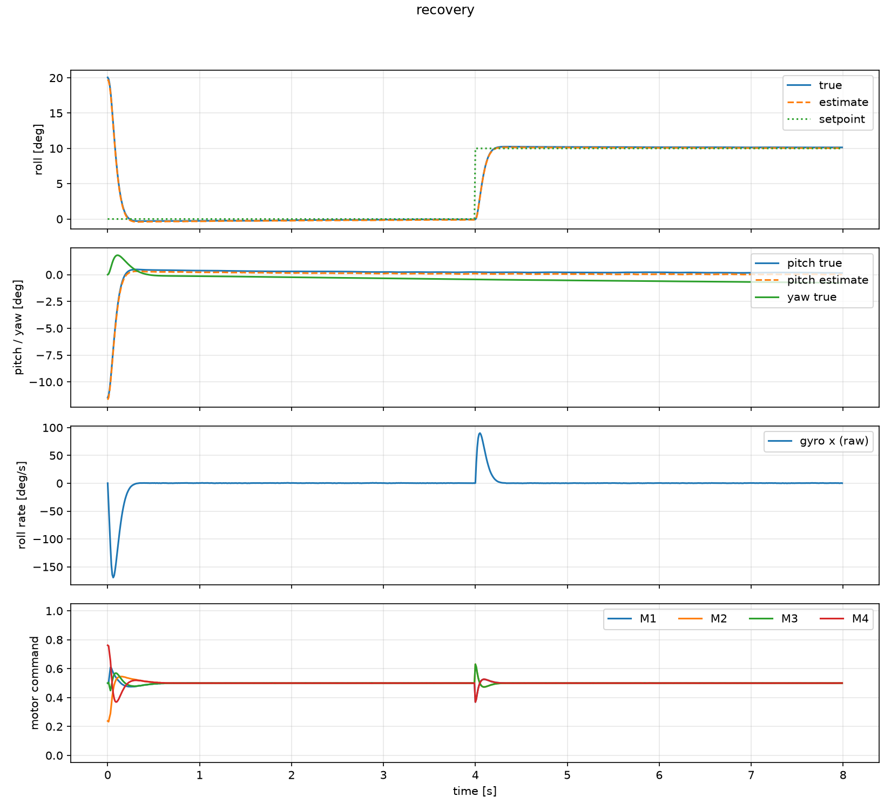
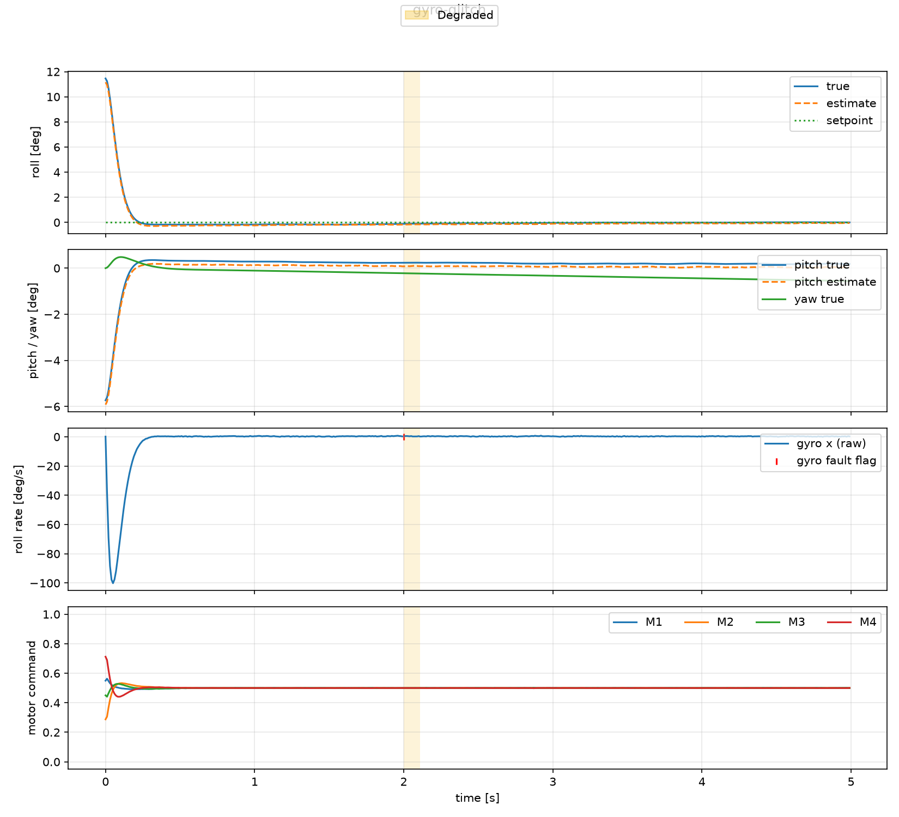
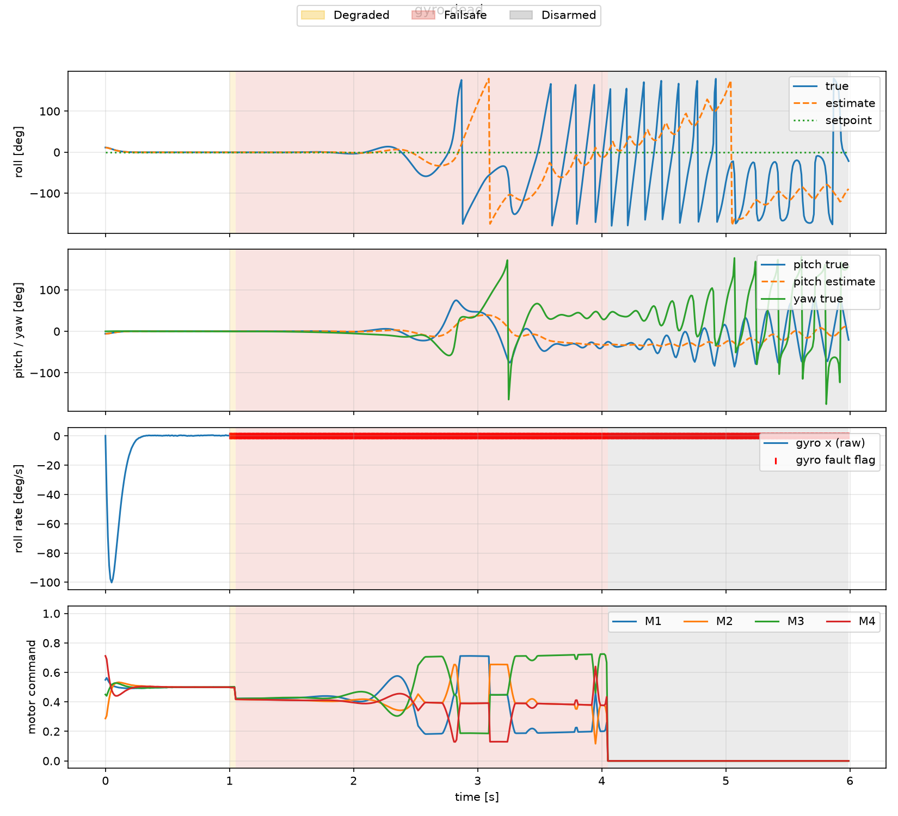
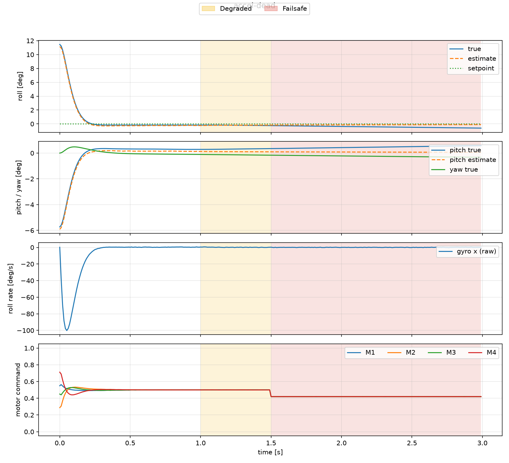
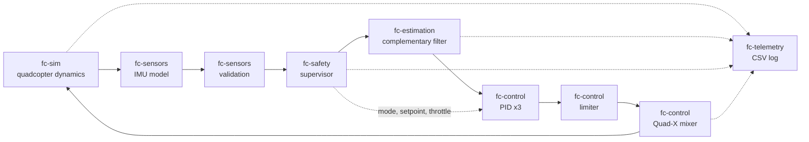

# UAV Flight Control Simulation (Rust)

[](https://github.com/kshiresanika/uav-flight-control/actions/workflows/ci.yml)

A modular quadcopter flight-control simulation in Rust: IMU sensor processing,
attitude estimation, PID roll/pitch/yaw stabilization, Quad-X motor mixing,
sensor validation, a failsafe state machine and CSV telemetry, all in a
deterministic fixed-step control loop.

> **Origin:** "Prototype first built at the
> European Defense Tech Hub, Berlin (08/2026); this repository is my own
> rebuilt and documented version, with tests, CI and telemetry."
>
> **Scope:** simulation only. This is a learning and portfolio project and is
> not intended for use on a real vehicle.

## Results

All four scenarios are flown by the same code. Each run writes a CSV that
`scripts/plot_telemetry.py` turns into the plots below (true vs. estimated
attitude, raw gyro with fault flags, motor commands, shaded flight modes).

| Scenario | What is injected | Outcome |
|---|---|---|
| `recovery` | start tilted 20° / -11°, then a 10° roll command | final roll 10.1°, pitch 0.2°, mode Normal |
| `gyro-glitch` | 3 ms of NaN on the gyro | survived: brief Degraded, back to Normal, roll ≈ 0° |
| `gyro-dead` | gyro dead from t = 1 s | Degraded, then Failsafe (`GyroTimeout`), then Disarmed |
| `accel-dead` | accelerometer dead from t = 1 s | Failsafe (`AccelTimeout`) after 0.5 s, attitude stays stable on the gyro |






## Architecture



One tick (1 ms) runs the chain left to right. The controller only ever sees
sensor data, never the true state of the simulator.

| Crate | Responsibility |
|---|---|
| `fc-core` | `Vec3`, `Attitude`, angle wrapping, fixed time step, constants |
| `fc-sim` | rotational rigid-body dynamics of the quadcopter (the "world") |
| `fc-sensors` | IMU model (noise, bias), seeded RNG, signal validation |
| `fc-estimation` | complementary filter for roll/pitch/yaw |
| `fc-control` | PID with anti-windup, torque limiter, Quad-X mixer |
| `fc-safety` | supervisor: Normal, Degraded, Failsafe, Disarmed |
| `fc-telemetry` | CSV logger with decimation |
| `fc-app` | scenario runner and command-line entry point |

## Design decisions

- **Deterministic loop.** Fixed 1 kHz step counted in integer ticks, seeded
  noise generator, no wall-clock time, no threads in the flight path. The same
  build gives the same result on every run, and a test checks it.
- **Complementary filter.** Gyro for fast changes, accelerometer for slow
  drift correction (time constant 0.2 s). Cheap, two intuitive parameters,
  bounded error from gyro bias. Yaw cannot be corrected without a
  magnetometer and drifts at the gyro bias rate.
- **PID gains from the plant model**, not trial and error:
  `kp = I·ωn²`, `kd = 2·ζ·ωn·I`, then verified in simulation. Derivative acts
  on the gyro measurement (no derivative kick), is low-pass filtered, and the
  integrator uses conditional anti-windup.
- **Mixer desaturation.** When a motor would exceed its range, the torques are
  scaled together and the collective throttle is shifted: attitude authority
  is kept at the expense of thrust.
- **Validation before estimation.** NaN/Inf, range, jump and stuck-value checks
  on every IMU sample.
- **Untrusted data is not used as a reference.** Found by fault-injection
  testing: holding a stale accelerometer value made the filter pull toward
  it, so the estimator coasts on the gyro instead.
- **Failsafe is latched.** Different timeouts per sensor (gyro 50 ms,
  accelerometer 500 ms), hysteresis on recovery, and only an explicit
  `rearm()` leaves Disarmed.
- **No `unsafe` code** anywhere (workspace-wide `forbid`).

## Getting started

Requires Rust (stable). The plots additionally need Python with
`pandas` and `matplotlib`.

```bash
cargo test --workspace                       # all unit and integration tests
cargo run -p fc-app -- recovery out/recovery.csv
python scripts/plot_telemetry.py out/recovery.csv out/recovery.png
```

Scenario names: `recovery`, `gyro-glitch`, `gyro-dead`, `accel-dead`.

## Testing

Unit tests per crate, closed-loop integration tests (step response, saturation,
disturbance rejection), fault-injection scenarios, and a seeded random-garbage
test that asserts every motor command stays finite and within [0, 1] on every
tick. CI runs rustfmt, clippy (warnings are errors) and the tests on Linux and
Windows, then flies all scenarios and uploads the plots.
See [docs/TESTING.md](docs/TESTING.md) for the claim-to-test mapping.

## Limitations

- Rotation only: no position, altitude or wind.
- Motors are instantaneous with thrust linear in the command; no battery model.
- The accelerometer model assumes hover (gravity only).
- Single IMU, so a plausible-but-wrong sensor value is not detectable.
- Independent single-axis PID loops, not a cascaded angle/rate controller.
- Not `no_std` yet. The flight path has no I/O, threads or heap allocation,
  which makes a port realistic, but trigonometry would need `libm`.
- Results across operating systems agree within tolerance, not bit for bit.
- No hardware-in-the-loop and no timing analysis.

